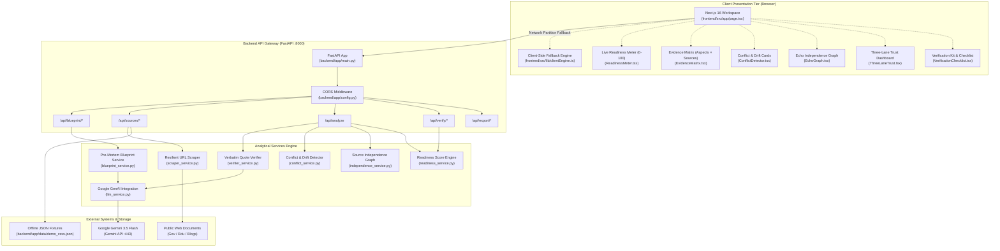

# ApexAudit: Technical Architecture & System Specification 🛡️

> **Document Classification**: System Architecture & Technical Design Specification  
> **Target Subsystem**: ApexAudit Full-Stack Monorepo  
> **Interactive Architecture Diagram**: [`architecture.html`](file:///c:/Users/DELL/Desktop/Blindspot/architecture/architecture.html)  
> **Location**: [`architecture/architecture.md`](file:///c:/Users/DELL/Desktop/Blindspot/architecture/architecture.md)  
> **Author**: Principal Software Architect & Documentation Engineer  
> **Status**: Approved Architecture Specification (v1.0.0)

---

## Table of Contents

1. [Executive Summary & The Decision-Readiness Paradigm](#1-executive-summary--the-decision-readiness-paradigm)
2. [High-Level System Topology](#2-high-level-system-topology)
   - [2.1 Decoupled Monorepo Structure](#21-decoupled-monorepo-structure)
   - [2.2 System Architecture Diagram](#22-system-architecture-diagram)
   - [2.3 Google Gemini AI Integration Engine](#23-google-gemini-ai-integration-engine)
3. [Next.js Frontend Architecture](#3-nextjs-frontend-architecture)
   - [3.1 Decision Workspace & Layout](#31-decision-workspace--layout)
   - [3.2 Zero-Persistence Ephemeral State Machine](#32-zero-persistence-ephemeral-state-machine)
   - [3.3 Key UI Components & Visualizations](#33-key-ui-components--visualizations)
   - [3.4 Client-Side Fallback Engine (`clientEngine.ts`)](#34-client-side-fallback-engine-clientenginets)
4. [FastAPI Backend Architecture](#4-fastapi-backend-architecture)
   - [4.1 Uvicorn ASGI Server & Gateway Layer](#41-uvicorn-asgi-server--gateway-layer)
   - [4.2 API Endpoint Registry](#42-api-endpoint-registry)
   - [4.3 Pydantic Data Models & Typed Schemas](#43-pydantic-data-models--typed-schemas)
5. [Multi-Tier Resilient URL Scraper](#5-multi-tier-resilient-url-scraper)
   - [5.1 SSRF Sandboxing & Network Validation](#51-ssrf-sandboxing--network-validation)
   - [5.2 4-Tier Network Resilience Pipeline](#52-4-tier-network-resilience-pipeline)
   - [5.3 DOM Extraction & Noise Decomposition](#53-dom-extraction--noise-decomposition)
   - [5.4 Temporal Metadata & Authority Scoring](#54-temporal-metadata--authority-scoring)
6. [Quote-Verified Evidence Matrix](#6-quote-verified-evidence-matrix)
   - [6.1 The Zero-Hallucination Axiom](#61-the-zero-hallucination-axiom)
   - [6.2 Verbatim Verification Algorithm](#62-verbatim-verification-algorithm)
   - [6.3 4-State Matrix Topology](#63-4-state-matrix-topology)
7. [Policy Conflict & Echo Graph Detection](#7-policy-conflict--echo-graph-detection)
   - [7.1 Pairwise Cross-Source Conflict Engine](#71-pairwise-cross-source-conflict-engine)
   - [7.2 Temporal Drift Detection](#72-temporal-drift-detection)
   - [7.3 Source Independence & Echo Graph Engine](#73-source-independence--echo-graph-engine)
8. [Trust Dashboards & Live Readiness Calculation](#8-trust-dashboards--live-readiness-calculation)
   - [8.1 The Three-Lane Trust Model](#81-the-three-lane-trust-model)
   - [8.2 Live Decision Readiness Score Algorithm](#82-live-decision-readiness-score-algorithm)
   - [8.3 Actionable Verification Kit (`Impact × Uncertainty`)](#83-actionable-verification-kit-impact--uncertainty)
9. [Database & State Interactions](#9-database--state-interactions)
   - [9.1 Stateless Backend Rationale](#91-stateless-backend-rationale)
   - [9.2 Offline JSON Fixtures (`demo_csss.json`)](#92-offline-json-fixtures-demo_csssjson)
   - [9.3 In-Memory LRU Blueprint Caching](#93-in-memory-lru-blueprint-caching)
10. [Companion Artifacts & Interactive Exploration](#10-companion-artifacts--interactive-exploration)

---

## 1. Executive Summary & The Decision-Readiness Paradigm

Traditional search engines index and rank documents; summarization engines condense large documents into short paragraphs. However, high-stakes decision-makers (such as students applying for renewal scholarships, immigrants petitioning for visas, or entrepreneurs filing commercial compliance permits) face a critical problem that neither search nor summarization solves:

> **"What vital requirements do you still not know, what contradictory policies exist across your sources, and which claims are uncorroborated echoes?"**

Acting on incomplete, outdated, or contradictory rules leads to real-world disqualification, application rejections, financial penalties, or missed deadlines.

**ApexAudit** addresses this gap by implementing an adversarial, pre-mortem decision-readiness pipeline:
1. **Pre-Mortem Inversion**: Formulates catastrophic failure modes worked backward into mandatory knowledge criteria.
2. **Quote-Grounded Verification**: Requires that every claim carry an exact verbatim substring located in the source text; ungrounded assertions are discarded.
3. **Cross-Source Contradiction & Echo Auditing**: Identifies conflicting criteria and uncredited circular citations between sources.
4. **Live Readiness Score**: Calculates a mathematically penalized 0–100 Readiness Score accompanied by an actionable verification kit.

For an interactive, visual exploration of this runtime architecture, open [`architecture.html`](file:///c:/Users/DELL/Desktop/Blindspot/architecture/architecture.html) in any browser.

---

## 2. High-Level System Topology

### 2.1 Decoupled Monorepo Structure

ApexAudit is organized as a decoupled monorepo separating client presentation, server-side analytical services, and offline fixtures:

```
c:\Users\DELL\Desktop\Blindspot\
├── architecture/                     # Architecture Documentation & Interactive Visualizers
│   ├── architecture.md               # THIS FILE: Technical architecture specification
│   ├── architecture.html             # Standalone Archify interactive runtime architecture diagram
│   ├── architecture.finalize.json    # Architecture validation receipt
│   └── architecture.browser-check.json # Automated browser evidence receipt
│
├── frontend/                         # Next.js 16+ App Router (TypeScript, Tailwind CSS)
│   ├── src/app/                      # Root layout, global styles, and page workspace
│   ├── src/components/               # UI components (Matrix, Conflicts, Echoes, Trust, Score)
│   └── src/lib/                      # API client, types, and client fallback engine
│
├── backend/                          # FastAPI Backend (Python 3.12, Uvicorn, Pydantic)
│   ├── app/main.py                   # FastAPI application & middleware configuration
│   ├── app/config.py                 # Application settings & Gemini environment configuration
│   ├── app/models/schemas.py         # Pydantic v2 data models
│   ├── app/routes/                   # Blueprint, Sources, Analyze, Verify, Export routers
│   ├── app/services/                 # Scraper, Verifier, Conflict, Independence, Readiness
│   └── app/data/demo_csss.json       # Pre-cached Central Sector Scholarship demo pack
│
├── docker-compose.yml                # Multi-container orchestration (Frontend + Backend)
└── package.json                      # Root workspace scripts
```

---

### 2.2 System Architecture Diagram



---

### 2.3 Google Gemini AI Integration Engine

The backend integrates with Google Gemini via the official `google-genai` SDK in [`backend/app/services/llm_service.py`](file:///c:/Users/DELL/Desktop/Blindspot/backend/app/services/llm_service.py):

- **Model Specification**: Defaults to `gemini-3.5-flash` (configurable via `GEMINI_MODEL`), chosen for fast reasoning and low latency.
- **Strict JSON Output Mode**: Requests pass `response_mime_type="application/json"` with a low temperature (0.2 for blueprints, 0.1 for claims), guaranteeing structured JSON matching Pydantic schemas.
- **Fast-Fail Timeout Safeguard**: Configured via `GEMINI_TIMEOUT_SECONDS` (default 4.0–5.0 seconds). If Gemini hits network latency or quota limits, the system fails fast to deterministic domain heuristics without stalling the user session.
- **In-Memory Blueprint Cache (`_BLUEPRINT_CACHE`)**: An LRU-style memory cache indexed by `{goal}::{context}` resolves repeated requests in under 1 millisecond.
- **Post-LLM Verbatim Enforcement**: Claims returned by Gemini are matched against the raw source text using `verify_quote_verbatim()`. Non-verbatim hallucinations are discarded before entering the evidence matrix.

---

## 3. Next.js Frontend Architecture

### 3.1 Decision Workspace & Layout

The frontend is built on **Next.js 16+ App Router** in [`frontend/src/app/page.tsx`](file:///c:/Users/DELL/Desktop/Blindspot/frontend/src/app/page.tsx), providing an interactive workspace:

- **Pristine Initial State**: Mounts with an empty canvas, avoiding hardcoded mock data.
- **Progressive Disclosure**: Guides users through 4 stages: Goal formulation $\rightarrow$ Pre-mortem blueprint review $\rightarrow$ Source ingestion $\rightarrow$ Audit evaluation.
- **Collapsible Navigation & Theme Engine**: Features an accessible sidebar ([`Sidebar.tsx`](file:///c:/Users/DELL/Desktop/Blindspot/frontend/src/components/Sidebar.tsx)) and dark/light mode toggle ([`ThemeToggle.tsx`](file:///c:/Users/DELL/Desktop/Blindspot/frontend/src/components/ThemeToggle.tsx)).

---

### 3.2 Zero-Persistence Ephemeral State Machine

ApexAudit enforces a **Privacy-First Zero-Persistence Policy**:
- **No Remote Database**: User goals, private documents, pasted text, and audit matrices are never persisted to a central database or disk.
- **Client-Side React State**: All active session context lives in the browser's React memory:
  - `goal`: User objective string.
  - `blueprint`: Array of `BlueprintItem` objects.
  - `sources`: Array of `SourceInput` objects.
  - `analysis`: `AnalysisResponse` object containing the matrix, conflicts, and readiness score.
  - `verifiedChecklistIds`: Array of user-verified item identifiers.
- **Stateless Backend**: The FastAPI backend acts as an idempotent functional engine, receiving complete state payloads in each request and returning processed audit findings.

---

### 3.3 Key UI Components & Visualizations

| Component | File Path | Functional Role |
| :--- | :--- | :--- |
| **EvidenceMatrix** | [`EvidenceMatrix.tsx`](file:///c:/Users/DELL/Desktop/Blindspot/frontend/src/components/EvidenceMatrix.tsx) | Displays the Aspects $\times$ Sources grid with color-coded status badges (*Covered*, *Conflicting*, *Outdated*, *Missing*) and clickable verbatim quote inspectors. |
| **ConflictDetector** | [`ConflictDetector.tsx`](file:///c:/Users/DELL/Desktop/Blindspot/frontend/src/components/ConflictDetector.tsx) | Renders side-by-side contrasting claims with exact citations, source authority tags, and severity levels (`CRITICAL`, `WARNING`, `NOTE`). |
| **EchoGraph** | [`EchoGraph.tsx`](file:///c:/Users/DELL/Desktop/Blindspot/frontend/src/components/EchoGraph.tsx) | Visualizes source independence and highlights circular citations or copycat syndication using Jaccard n-gram similarity metrics. |
| **ThreeLaneTrust** | [`ThreeLaneTrust.tsx`](file:///c:/Users/DELL/Desktop/Blindspot/frontend/src/components/ThreeLaneTrust.tsx) | Segregates evidence into 3 lanes: Quote-Grounded Facts, Inferred AI Rules, and Not Found Gaps. |
| **ReadinessMeter** | [`ReadinessMeter.tsx`](file:///c:/Users/DELL/Desktop/Blindspot/frontend/src/components/ReadinessMeter.tsx) | Interactive circular gauge displaying the live 0–100 score and penalty breakdown (Coverage, Freshness, Conflicts, Echoes, Verification Bonus). |
| **VerificationChecklist** | [`VerificationChecklist.tsx`](file:///c:/Users/DELL/Desktop/Blindspot/frontend/src/components/VerificationChecklist.tsx) | Ranked checklist sorted by $\text{Impact} \times \text{Uncertainty}$ with official portal links, draft clarification emails, and "Mark as Verified" actions. |
| **BlueprintEditor** | [`BlueprintEditor.tsx`](file:///c:/Users/DELL/Desktop/Blindspot/frontend/src/components/BlueprintEditor.tsx) | Allows users to edit, add, or reprioritize failure criteria before running the audit. |
| **SourceManager** | [`SourceManager.tsx`](file:///c:/Users/DELL/Desktop/Blindspot/frontend/src/components/SourceManager.tsx) | Ingests live URLs, opens the Pasted Text Fallback modal, and loads the 1-click CSSS Demo Pack. |

---

### 3.4 Client-Side Fallback Engine (`clientEngine.ts`)

In [`frontend/src/lib/clientEngine.ts`](file:///c:/Users/DELL/Desktop/Blindspot/frontend/src/lib/clientEngine.ts), ApexAudit provides an isomorphic TypeScript evaluation engine:
- If `runAnalysis()` in [`api.ts`](file:///c:/Users/DELL/Desktop/Blindspot/frontend/src/lib/api.ts) encounters a network partition, backend outage, or 20-second timeout, it automatically invokes `evaluateLocally()`.
- The client engine performs local verbatim quote search, conflict detection, temporal drift analysis, shingle independence checks, and readiness scoring.
- The UI renders the complete audit dashboard with an offline indicator banner, preventing application lockups.

---

## 4. FastAPI Backend Architecture

### 4.1 Uvicorn ASGI Server & Gateway Layer

The backend is built with **FastAPI (Python 3.12)** in [`backend/app/main.py`](file:///c:/Users/DELL/Desktop/Blindspot/backend/app/main.py):
- **CORS Middleware**: Validates origins via `ALLOWED_ORIGINS` in [`config.py`](file:///c:/Users/DELL/Desktop/Blindspot/backend/app/config.py), supporting `localhost:3000`, `127.0.0.1:3000`, and custom production domains.
- **ASGI Concurrency**: Powered by Uvicorn, handling asynchronous HTTP requests with sub-millisecond route dispatching.

---

### 4.2 API Endpoint Registry

```
FastAPI Router (/api)
├── /blueprint
│   └── POST /generate       ──► Generates pre-mortem blueprint items from goal
├── /sources
│   ├── GET  /demos           ──► Lists available pre-cached demo packages
│   ├── GET  /demo/{demo_id}  ──► Loads complete demo dataset (CSSS Scholarship)
│   └── POST /fetch           ──► Scrapes live URL with SSRF protection & 4-tier fallbacks
├── /analyze
│   └── POST ""               ──► Runs full decision audit (claims, conflicts, matrix, score)
├── /verify
│   └── POST /mark            ──► Updates user verification state and recalculates score
└── /export
    ├── POST /markdown        ──► Downloads executive audit report as Markdown file
    └── POST /markdown/text   ──► Returns raw Markdown report content
```

---

### 4.3 Pydantic Data Models & Typed Schemas

Defined in [`backend/app/models/schemas.py`](file:///c:/Users/DELL/Desktop/Blindspot/backend/app/models/schemas.py) and mirrored in TypeScript [`frontend/src/lib/types.ts`](file:///c:/Users/DELL/Desktop/Blindspot/frontend/src/lib/types.ts):

- `BlueprintItem`: `id`, `aspect`, `failure_scenario`, `criticality` (`HIGH`, `MEDIUM`, `LOW`), `description`, `weight` (1.0, 0.6, 0.3).
- `SourceInput`: `id`, `title`, `url`, `raw_text`, `source_type` (`official`, `aggregator`, `forum`, `user_pasted`), `published_date`, `authority_score` (0.0 to 1.0).
- `Claim`: `id`, `source_id`, `aspect_id`, `claim_text`, `exact_quote`, `verified_verbatim`, `char_start`, `char_end`, `extracted_value`, `confidence`.
- `ConflictFinding`: `id`, `aspect_id`, `aspect_name`, `source_a_id`, `claim_a`, `quote_a`, `source_b_id`, `claim_b`, `quote_b`, `contrast_summary`, `severity` (`CRITICAL`, `WARNING`, `NOTE`).
- `TemporalDriftFinding`: `id`, `source_id`, `source_title`, `detected_date`, `is_outdated`, `reason`, `caution_message`.
- `IndependenceEdge`: `source_a_id`, `source_b_id`, `relation_type` (`independent`, `echo_source`, `derived_copy`, `syndication`), `similarity_score`, `shared_phrases`, `risk_summary`.
- `ReadinessScore`: `score` (0–100), `status` (`Decision Ready`, `Needs Verification`, `High Risk / Blindspots Present`), `breakdown` (`base_coverage_score`, `freshness_penalty`, `conflict_penalty`, `echo_penalty`, `user_verified_bonus`, `final_score`).

---

## 5. Multi-Tier Resilient URL Scraper

Implemented in [`backend/app/services/scraper_service.py`](file:///c:/Users/DELL/Desktop/Blindspot/backend/app/services/scraper_service.py), the scraper ingests web documents from government portals, academic institutions, and aggregator sites.

```
Incoming URL
     │
     ▼
[ SSRF Guard ] ────────► Reject if loopback, private IP, or cloud metadata
     │
     ▼ Safe Public URL
┌────────────────────────────────────────────────────────┐
│ 4-Tier Network Fetch Pipeline                          │
│                                                        │
│ [ Tier 1 ]: HTTPX + Chrome User-Agent + Strict SSL     │
│             ├──► Success: 200 OK                       │
│             └──► SSL Error / 403 Forbidden             │
│                   │                                    │
│ [ Tier 2 ]: HTTPX + SSL Fallback (verify=False)        │
│             ├──► Success: 200 OK                       │
│             └──► 403 Forbidden / WAF Filter            │
│                   │                                    │
│ [ Tier 3 ]: HTTPX + Wikimedia Bot Headers              │
│             ├──► Success: 200 OK                       │
│             └──► Connection Failure                    │
│                   │                                    │
│ [ Tier 4 ]: Urllib Request + Firefox UA + CERT_NONE    │
│             └──► Raw HTML or Graceful Fallback         │
└────────────────────────────────────────────────────────┘
     │
     ▼
[ DOM Cleaner & Boilerplate Decomposer ] (Removes scripts, styles, navs, footers)
     │
     ▼
[ Metadata & Date Extractor ] (OpenGraph, Dublin Core, <time>, ISO regex)
     │
     ▼
[ Domain Heuristic Classifier ] (Calculates authority_score & source_type)
     │
     ▼
SourceInput Object
```

### 5.1 SSRF Sandboxing & Network Validation
- **Scheme Validation**: Permits only `http://` and `https://`.
- **IP Range Filtering**: Resolves hostnames via `socket.gethostbyname()` and blocks loopback (`127.0.0.1`, `localhost`), link-local, private subnets (RFC 1918), and cloud instance metadata endpoints (`169.254.169.254`, `metadata.google.internal`).

### 5.2 4-Tier Network Resilience Pipeline
1. **Tier 1 (Modern Chrome)**: HTTP/2-ready `httpx.AsyncClient` with modern Chromium User-Agent and strict SSL certificate validation.
2. **Tier 2 (SSL Fallback)**: Re-attempts with `verify=False` to handle state educational portals and government servers with expired or misconfigured intermediate certificates.
3. **Tier 3 (Wikimedia Compliance)**: Applies `WIKIMEDIA_HEADERS` (`ApexAuditResearchBot/2.0; research@apexaudit.dev`) to prevent HTTP 403 errors on Wikipedia/Wikimedia domains.
4. **Tier 4 (Urllib Socket Fallback)**: Low-level `urllib.request` with `ssl.CERT_NONE` and Firefox headers to bypass anti-bot WAFs that block asynchronous HTTP client signatures.

### 5.3 DOM Extraction & Noise Decomposition
- Targets semantic containers (`article`, `main`, `#content`, `.post-content`, `#mw-content-text`).
- Recursively strips noise tags (`script`, `style`, `nav`, `footer`, `header`, `noscript`, `svg`, `iframe`, `form`, `button`, `aside`) and Wikipedia editing clutter (`.mw-editsection`, `.navbox`, `.reflist`).
- Safe text length cap at 25,000 characters.

### 5.4 Temporal Metadata & Authority Scoring
- **Date Extraction**: Searches HTML meta properties (`article:published_time`, `article:modified_time`, `og:updated_time`, `DC.date.issued`, `sailthru.date`), HTML5 `<time>` tags, and regex date patterns.
- **Authority Heuristics**:
  - Government / Academic (`.gov`, `.gov.in`, `.nic.in`, `.edu`, `.ac.in`): `official` (0.95)
  - Encyclopedias / Reference (`wikipedia.org`, `wikimedia.org`): `aggregator` (0.85)
  - Major News / Reference Publishers (`reuters.com`, `thehindu.com`, etc.): `aggregator` (0.80)
  - Community Forums (`reddit.com`, `quora.com`, `x.com`): `forum` (0.40)
  - Default Open Web: `aggregator` (0.65)

---

## 6. Quote-Verified Evidence Matrix

Implemented in [`backend/app/services/verifier_service.py`](file:///c:/Users/DELL/Desktop/Blindspot/backend/app/services/verifier_service.py).

### 6.1 The Zero-Hallucination Axiom
Generative AI models are prone to hallucinating citations and plausible-sounding policies. ApexAudit enforces the Zero-Hallucination Axiom: **no claim may enter the evidence matrix or influence the Readiness Score unless it contains an exact, verbatim substring verified in the source text.**

### 6.2 Verbatim Verification Algorithm
```python
def verify_quote_verbatim(quote: str, raw_text: str) -> Tuple[bool, Optional[int], Optional[int]]:
    if not quote or not raw_text:
        return False, None, None

    # Step 1: Direct exact substring search
    idx = raw_text.find(quote)
    if idx != -1:
        return True, idx, idx + len(quote)

    # Step 2: Whitespace and typographical quote normalization
    norm_quote = normalize_text_for_search(quote).strip()
    norm_raw = normalize_text_for_search(raw_text)

    # Step 3: Flexible intra-word whitespace regex
    escaped_tokens = [re.escape(tok) for tok in norm_quote.split()]
    pattern = r'\s+'.join(escaped_tokens)
    match = re.search(pattern, norm_raw, flags=re.IGNORECASE)
    if match:
        return True, match.start(), match.end()

    return False, None, None
```

### 6.3 4-State Matrix Topology
Every cell in the **Aspects $\times$ Sources** grid is assigned one of four states:
- **`Covered` (Green)**: The requirement is verified in the source text via an exact verbatim quote.
- **`Conflicting` (Red)**: The requirement is discussed, but contradicts claims in other sources.
- **`Outdated` (Yellow)**: The source addressing the requirement is temporally drifted (e.g., from an earlier fiscal year).
- **`Missing` (Gray)**: The requirement is absent or ungrounded in the source text.

---

## 7. Policy Conflict & Echo Graph Detection

### 7.1 Pairwise Cross-Source Conflict Engine
Implemented in [`backend/app/services/conflict_service.py`](file:///c:/Users/DELL/Desktop/Blindspot/backend/app/services/conflict_service.py):
- Groups verified claims by `aspect_id` and evaluates pairs from distinct sources ($Source_A \neq Source_B$).
- Identifies numerical, date, and policy contradictions:
  - Income limits: Rs. 4,50,000 (Official Guidelines) vs. Rs. 8,00,000 (Aggregator Blog).
  - Academic cutoffs: 50% aggregate marks vs. 60% semester marks.
  - Filing deadlines: October 31 closing vs. December 31 extension.
  - DBT mandates: Mandatory Aadhaar seeding on the NPCI mapper vs. claims that Aadhaar is optional.
- Formulates contrast summaries using transparent language (*"Possible discrepancy in family income ceiling..."*).

### 7.2 Temporal Drift Detection
- Compares source publication dates against the current operational cycle (e.g., `year < 2024`).
- Scans source text for retrospective markers (*"older circulars"*, *"previous year guidelines"*).
- Attaches caution advisories warning users of superseded rules.

### 7.3 Source Independence & Echo Graph Engine
Implemented in [`backend/app/services/independence_service.py`](file:///c:/Users/DELL/Desktop/Blindspot/backend/app/services/independence_service.py):
- **4-Word Shingle Jaccard Similarity**: Computes text overlap between all source pairs:
  $$J(S_1, S_2) = \frac{|Shingles(S_1) \cap Shingles(S_2)|}{|Shingles(S_1) \cup Shingles(S_2)|}$$
- **Verbatim Window Sliding**: Slides windows of 12, 8, and 6 words to detect identical sentence fragments.
- **Relationship Classification**:
  - `echo_source` ($J > 0.35$ or $\ge 2$ shared multi-word phrases): Direct copycat; triggers echo penalty.
  - `derived_copy` ($J > 0.15$ or $\ge 1$ shared phrase): Moderate aggregation overlap.
  - `independent` ($J \le 0.15$): Distinct, independently authored documents.

---

## 8. Trust Dashboards & Live Readiness Calculation

### 8.1 The Three-Lane Trust Model
To prevent cognitive overload, evidence is segregated into three trust lanes in [`frontend/src/components/ThreeLaneTrust.tsx`](file:///c:/Users/DELL/Desktop/Blindspot/frontend/src/components/ThreeLaneTrust.tsx):
1. **Quote-Grounded Facts (Lane 1)**: Verbatim quotes verified against source text with character offsets.
2. **AI-Suggested Rules (Lane 2)**: Inferred pre-mortem requirements and prospective failure modes generated by the blueprint.
3. **Not Found Gaps (Lane 3)**: Mandatory blueprint requirements missing across all reviewed sources.

---

### 8.2 Live Decision Readiness Score Algorithm
Implemented in [`backend/app/services/readiness_service.py`](file:///c:/Users/DELL/Desktop/Blindspot/backend/app/services/readiness_service.py):

$$\text{BaseCoverage} = \frac{\sum_{i \in \text{Blueprint}} w_i \cdot C(i)}{\sum_{i \in \text{Blueprint}} w_i} \times 100$$

Where $C(i)$ is:
- $1.0$: Fully covered by independent, current sources, or verified by the user.
- $0.5$: Covered, but only by outdated or echo sources.
- $0.25$: Covered, but involved in an active contradiction.
- $0.0$: Missing / unmentioned.

**Penalties & Bonuses**:
$$\text{ConflictPenalty} = \min(35.0, \; \text{count}(\text{conflicts}) \times 12.0)$$
$$\text{FreshnessPenalty} = \min(25.0, \; \text{count}(\text{temporal\_drifts}) \times 8.0)$$
$$\text{EchoPenalty} = \min(20.0, \; \text{count}(\text{echo\_sources}) \times 7.0)$$
$$\text{UserVerifiedBonus} = \min(30.0, \; \text{count}(\text{user\_verified\_items}) \times 10.0)$$

$$\text{FinalScore} = \text{clamp}\Big(0, \, 100, \, \text{round}\big(\text{BaseCoverage} - \text{ConflictPenalty} - \text{FreshnessPenalty} - \text{EchoPenalty} + \text{UserVerifiedBonus}\big)\Big)$$

**Score Status Bands**:
- **80 – 100: "Decision Ready"**: High verified coverage, zero unresolved conflicts, independent sources.
- **50 – 79: "Needs Verification"**: Foundational information present, but uncorroborated items or minor conflicts require checking.
- **0 – 49: "High Risk / Blindspots Present"**: Critical gaps, direct contradictions, or heavy reliance on echo sources.

---

### 8.3 Actionable Verification Kit (`Impact × Uncertainty`)
Implemented in [`frontend/src/components/VerificationChecklist.tsx`](file:///c:/Users/DELL/Desktop/Blindspot/frontend/src/components/VerificationChecklist.tsx):
- **Priority Ranking Formula**:
  $$\text{PriorityScore} = \text{Impact} \times \text{Uncertainty}$$
  - $\text{Impact} \in [10 \,(\text{HIGH}), \, 6 \,(\text{MEDIUM}), \, 3 \,(\text{LOW})]$
  - $\text{Uncertainty} \in [10 \,(\text{Conflicting}), \, 9 \,(\text{Missing}), \, 7 \,(\text{Outdated}), \, 3 \,(\text{Verified in Doc}), \, 1 \,(\text{Verified by User})]$
- **Interactive Tools**:
  - Direct hyperlinks to official portals (National Scholarship Portal, PFMS, UIDAI).
  - Pre-drafted clarification emails addressed to institutional helpdesk officers.
  - Interactive **"Mark as Verified"** action that updates the live readiness meter in real time.

---

## 9. Database & State Interactions

### 9.1 Stateless Backend Rationale
ApexAudit adopts a stateless backend design:
- Eliminates compliance overhead (GDPR, CCPA) by avoiding database storage of user inputs or personal documents.
- Simplifies horizontal scaling behind load balancers without requiring database synchronizations.
- Prevents cross-session data leakage between users.

---

### 9.2 Offline JSON Fixtures (`demo_csss.json`)
The pre-cached demo pack at [`backend/app/data/demo_csss.json`](file:///c:/Users/DELL/Desktop/Blindspot/backend/app/data/demo_csss.json) models a real-world scholarship renewal scenario:
- **Source 1 (Official Guidelines)**: 2024 MoE scheme circular establishing official income limits, 50% marks cutoff, and mandatory NPCI Aadhaar seeding.
- **Source 2 (Aggregator Blog)**: 2023 blog containing outdated circular claims (Rs. 8L income, 60% marks, deadline extension to December 31).
- **Source 3 (Student Forum Echo)**: Forum post copying the aggregator blog verbatim, demonstrating echo source detection.

---

### 9.3 In-Memory LRU Blueprint Caching
To minimize external API calls and latency:
- Blueprints generated by Gemini are cached in memory (`_BLUEPRINT_CACHE` in [`llm_service.py`](file:///c:/Users/DELL/Desktop/Blindspot/backend/app/services/llm_service.py)).
- Requests matching known goals are served instantly from memory.

---

## 10. Companion Artifacts & Interactive Exploration

- **Interactive Architecture Viewer**: Open [`architecture.html`](file:///c:/Users/DELL/Desktop/Blindspot/architecture/architecture.html) to explore the visual runtime topology, animate message traces, inspect component boundaries, and switch between guided views (**System Topology**, **Source Ingestion**, **Audit & Verification**, and **Database & State**).
- **Architecture Validation Receipt**: [`architecture.finalize.json`](file:///c:/Users/DELL/Desktop/Blindspot/architecture/architecture.finalize.json) records the automated gate checks proving schema compliance, route clearance, and browser rendering integrity.
- **Delivery Manifest**: [`architecture.delivery.json`](file:///c:/Users/DELL/Desktop/Blindspot/architecture/architecture.delivery.json) confirms reproducible compilation from intermediate representation to standalone HTML.
